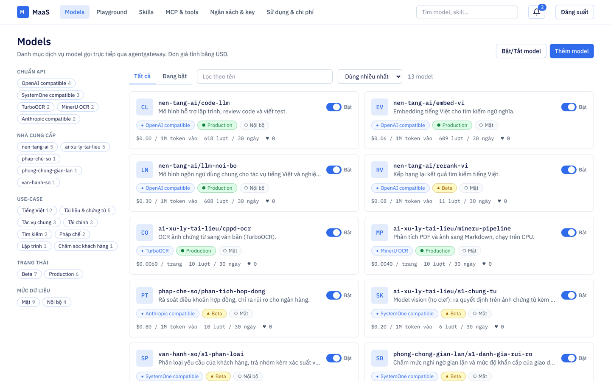
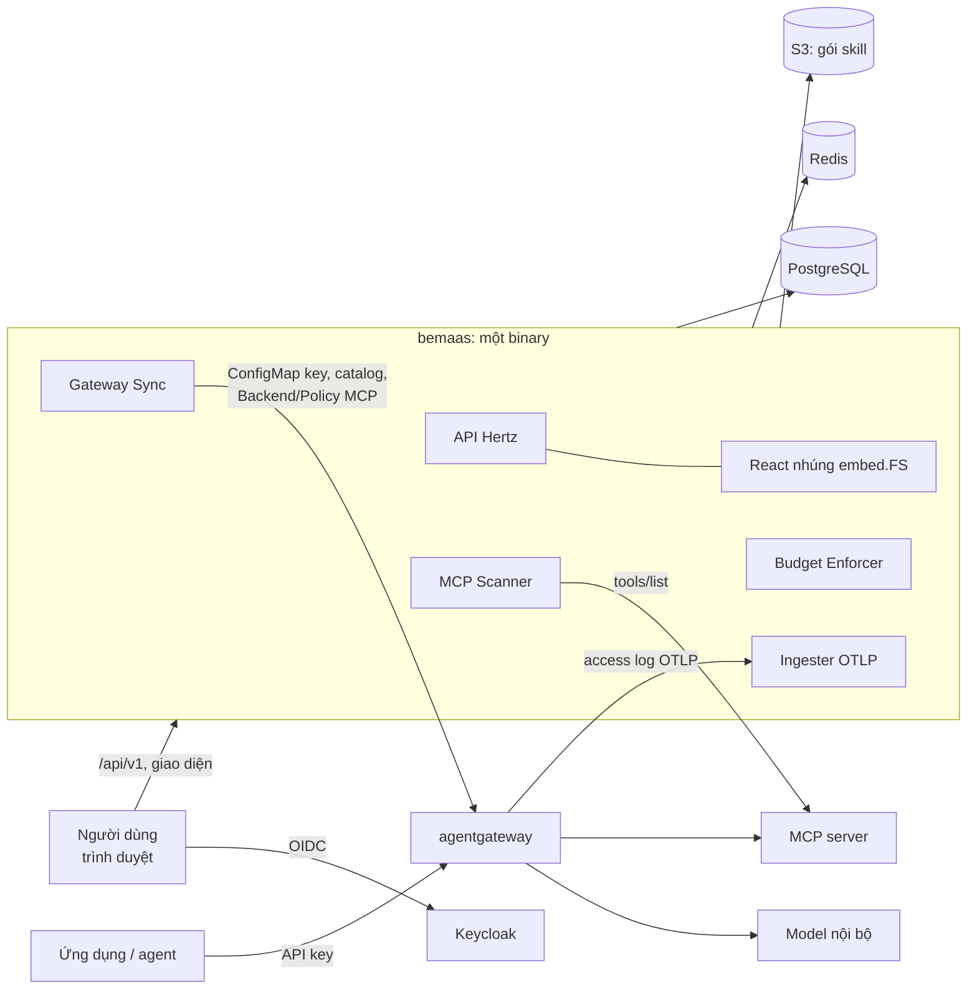
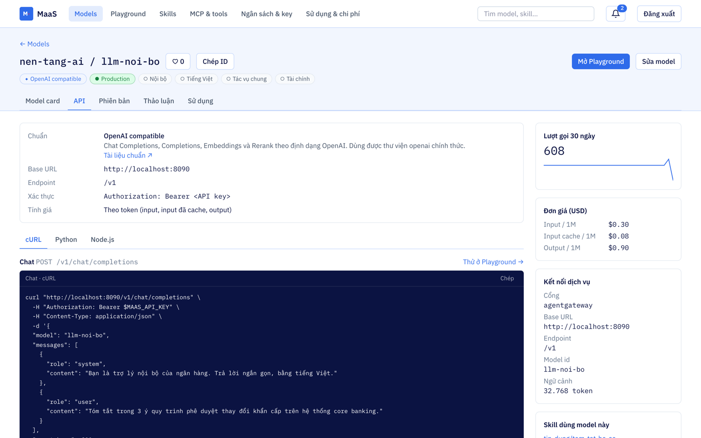
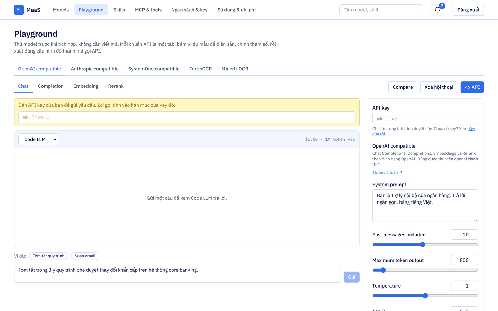
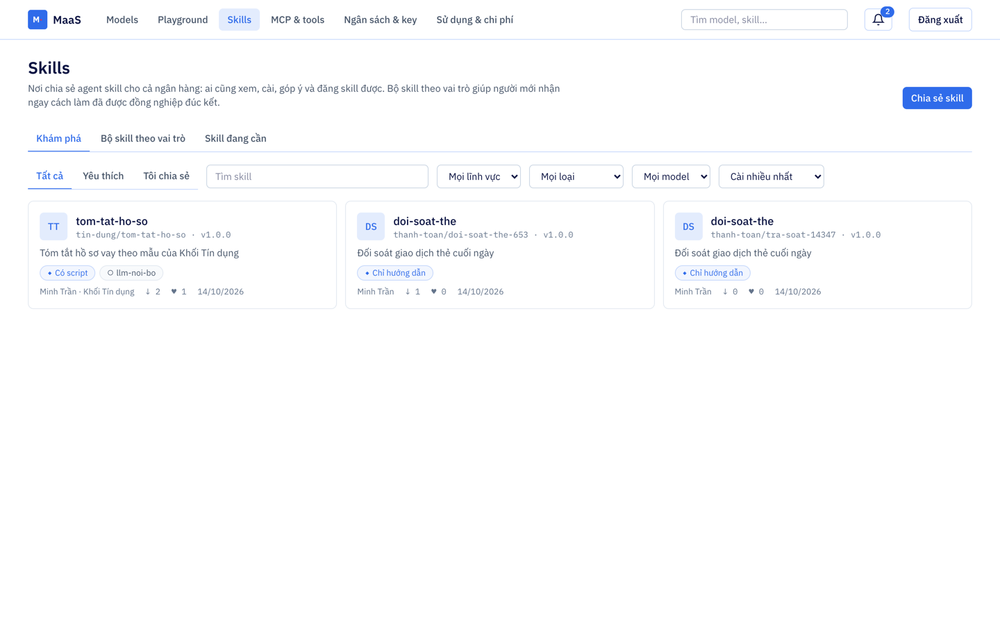
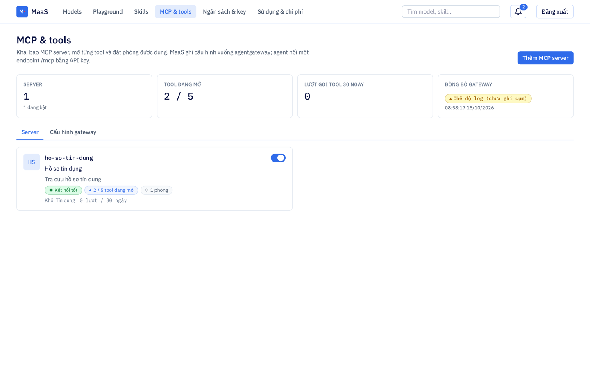
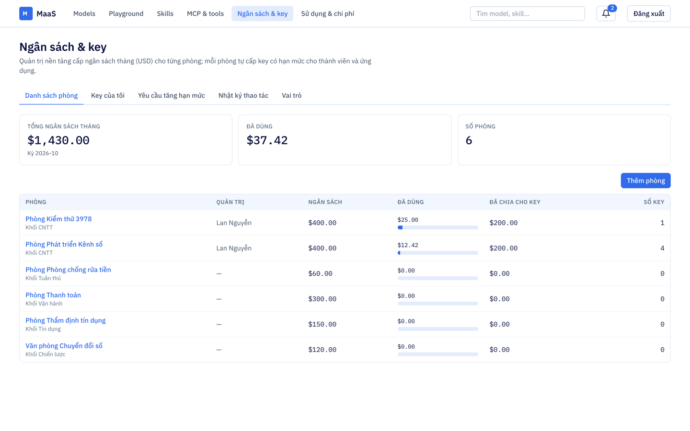
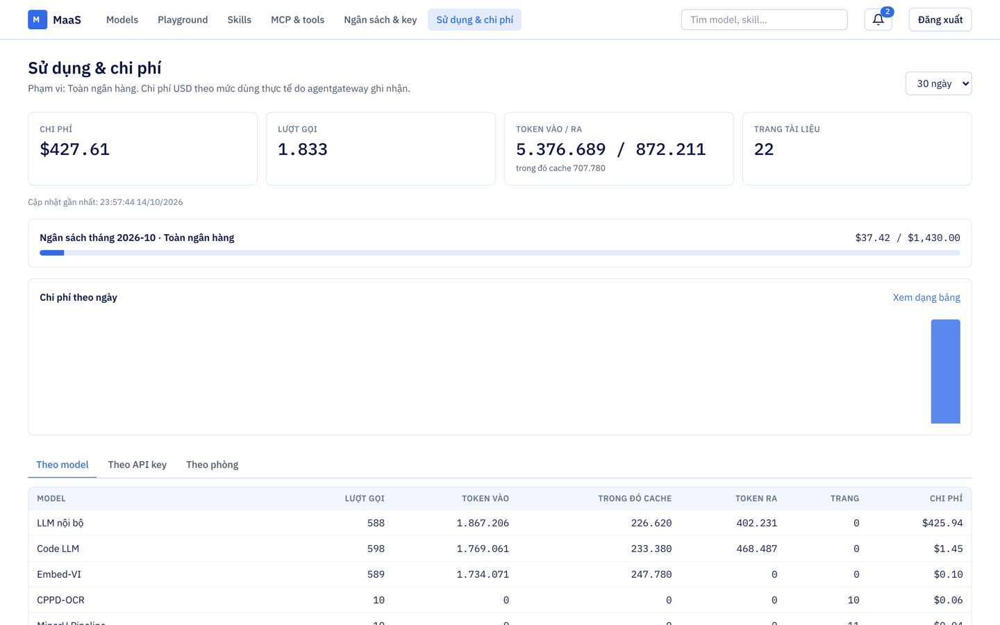

<p align="center">
  
</p>

<h1 align="center">bemaas</h1>

<p align="center">
  <b>Model-as-a-Service nội bộ cho ngân hàng</b><br>
  Danh mục model, Playground, Skill hub, MCP &amp; tools, ngân sách và API key trong một binary
</p>

<p align="center">
  
  
  
  
  
  
  
  <a href="LICENSE"></a>
</p>

<p align="center">
  <a href="#-tổng-quan">Tổng quan</a> •
  <a href="#-kiến-trúc">Kiến trúc</a> •
  <a href="#-tính-năng">Tính năng</a> •
  <a href="#-giao-diện">Giao diện</a> •
  <a href="#-bắt-đầu-nhanh">Bắt đầu nhanh</a> •
  <a href="#-cấu-hình">Cấu hình</a> •
  <a href="#-triển-khai">Triển khai</a> •
  <a href="#-giấy-phép">Giấy phép</a>
</p>

---

## 📖 Tổng quan

**bemaas** là nền tảng MaaS (Model-as-a-Service) dùng nội bộ ngân hàng, đặt trước [agentgateway](https://agentgateway.dev). Các phòng ban tìm model, thử ngay trên trình duyệt, nhận API key có hạn mức rồi gọi model qua gateway. Mọi lượt gọi được ghi nhận và trừ vào ngân sách của phòng.

- **Một binary**: API (Hertz) và giao diện React được nhúng bằng `embed.FS`. Không cần web server riêng.
- **Nhiều chuẩn API**: OpenAI, Anthropic, SystemOne, TurboOCR, MinerU. Tab API, mã mẫu và Playground tự dựng theo chuẩn của từng model.
- **Kiểm soát chi phí**: ngân sách tháng theo phòng, hạn mức theo key. Budget Enforcer tự khoá key vượt hạn mức.
- **Cấu hình tách khỏi giá trị**: `config.yaml` chỉ chứa `${BIẾN}`, giá trị thật nằm trong `.env`, ConfigMap hoặc Secret.

Đặc tả đầy đủ: [docs/spec-maas.md](docs/spec-maas.md). Các điểm cần đối chiếu với cụm thật: [docs/luu-y-trien-khai.md](docs/luu-y-trien-khai.md).

## 🏗 Kiến trúc



| Thành phần | Vai trò |
|---|---|
| **API** | REST `/api/v1`, xác thực bằng access token Keycloak. Vai trò lưu trong PostgreSQL |
| **Gateway Sync** | Ghi key (đã băm), bảng giá `catalog.json` và cấu hình MCP xuống agentgateway. Chế độ `log` hoặc `kubernetes` |
| **Ingester** | Nhận access log OTLP/HTTP của gateway, chống đếm trùng theo `request_id`, cộng dồn sử dụng theo tháng |
| **Budget Enforcer** | Định kỳ so sánh mức dùng với ngân sách. Khoá key vượt hạn mức và gửi thông báo ngưỡng |
| **MCP Scanner** | Quét `tools/list` và kiểm tra kết nối của các MCP server đã khai báo |

## ✨ Tính năng

| Phân hệ | Nội dung |
|---|---|
| **Models** | Danh mục lọc theo chuẩn API, nhà cung cấp, use-case, trạng thái, mức dữ liệu. Bật tắt từng model hoặc hàng loạt. Model card có các tab Model card, API, Phiên bản, Thảo luận, Sử dụng |
| **Playground** | Mỗi chuẩn API một tab, có ví dụ mẫu. Chat streaming và Compare, Completion, Embedding, Rerank, SystemOne decision, OCR ảnh và PDF. Hiện độ trễ, token hoặc số trang, chi phí. Xuất mã cURL, Python, Node.js |
| **Skill hub** | Khám phá, chia sẻ, đăng phiên bản, góp ý skill. Gói skill được tự kiểm tra lộ mật khẩu, khoá, số thẻ, CCCD. Có bộ skill theo vai trò và danh sách skill đang cần |
| **MCP & tools** | Khai báo MCP server (Streamable HTTP, SSE). Tool mới mặc định đóng, mở tool ghi phải xác nhận. Giới hạn theo phòng. Sinh `AgentgatewayBackend` và `AgentgatewayPolicy` |
| **Ngân sách & key** | Ngân sách tháng theo phòng, key có hạn mức và thời hạn, yêu cầu tăng hạn mức. Các vai trò Nền tảng, Quản trị phòng, Kiểm soát. Nhật ký thao tác chỉ ghi thêm |
| **Sử dụng & chi phí** | Thanh ngân sách, biểu đồ theo ngày hoặc tuần, bảng theo model, key, phòng |
| **Chung** | Ô tìm chung, chuông thông báo trong ứng dụng, giao diện co giãn 360–2560px |

## 🖼 Giao diện

<table>
  <tr>
    <td width="50%"><b>Danh mục model</b><br></td>
    <td width="50%"><b>Model card: tab API theo chuẩn</b><br></td>
  </tr>
  <tr>
    <td><b>Playground</b><br></td>
    <td><b>Skill hub</b><br></td>
  </tr>
  <tr>
    <td><b>MCP &amp; tools</b><br></td>
    <td><b>Ngân sách &amp; key</b><br></td>
  </tr>
  <tr>
    <td colspan="2"><b>Sử dụng &amp; chi phí</b><br></td>
  </tr>
</table>

## 🚀 Bắt đầu nhanh

Cần Go 1.26, Node 22, Docker.

```sh
cp .env.example .env # sửa nếu cần; make tự tạo nếu chưa có
make infra-up        # PostgreSQL :5432, Redis :6380, S3 (SeaweedFS) :9000, Keycloak :8180
make seed            # migration + danh mục model, bảng giá, phòng mẫu
make build           # build giao diện vào web/dist rồi build bin/bemaas
./bin/bemaas         # đọc ./config.yaml và ./.env
make devmock         # terminal khác: agentgateway và MCP server giả
```

Mở http://localhost:8080 và đăng nhập bằng tài khoản trong realm `maas` của Keycloak local ([deploy/keycloak/realm-maas.json](deploy/keycloak/realm-maas.json)). Email nằm trong `PLATFORM_ADMINS` được gán Quản trị nền tảng ở lần đăng nhập đầu.

Muốn có dữ liệu minh hoạ (gán phòng, tạo key, 30 ngày sử dụng): đăng nhập các tài khoản mẫu một lần rồi chạy `make seed-demo`.

Lúc khởi động, server chờ tối đa 60 giây cho PostgreSQL, S3 và Keycloak, nên chạy ngay sau `make infra-up` cũng được.

### Phát triển giao diện

```sh
make run        # backend :8080
make dev-web    # Vite :5173, proxy /api sang :8080
```

### Chạy thử trọn vòng với `make devmock`

`cmd/devmock` **chỉ dùng ở local**, giả lập các hệ thống bên ngoài:

| Cổng | Giả lập | Làm gì |
|---|---|---|
| 8090 | agentgateway | Xác thực API key bằng mã băm trong CSDL, chặn model đang tắt, trả lời theo từng chuẩn (OpenAI có streaming, Anthropic, SystemOne, TurboOCR, MinerU), gửi access log OTLP về Ingester |
| 8092 | MCP server | Streamable HTTP ở `/mcp`: 3 tool chỉ đọc, 1 tool ghi, 1 tool không khai báo `readOnlyHint` |

Thử như sau: vào **Ngân sách & key**, mở chi tiết phòng và cấp một key. Dán key vào Playground, chọn ví dụ rồi gửi. Vài giây sau số liệu xuất hiện ở **Sử dụng & chi phí**. Thêm MCP server `localhost:8092` ở **MCP & tools**.

## ⚙️ Cấu hình

- `config.yaml` được commit, chỉ chứa `${BIẾN}` hoặc `${BIẾN:-mặc định}`.
- `.env` không commit; mẫu ở [.env.example](.env.example).
- Biến môi trường có sẵn được ưu tiên hơn `.env`, nên trên Kubernetes chỉ cần gắn ConfigMap hoặc Secret.
- Thiếu biến bắt buộc thì server dừng và báo đúng tên biến.

| Nhóm | Biến | Ghi chú |
|---|---|---|
| Server | `SERVER_ADDR`, `SERVER_TIMEZONE`, `PLATFORM_ADMINS` | |
| PostgreSQL | `DB_*` | |
| Redis | `REDIS_*` | Redis lỗi thì vẫn chạy, chỉ không có cache |
| S3 | `S3_*` | Lưu gói skill |
| Keycloak | `OIDC_ISSUER`, `OIDC_CLIENT_ID`, `OIDC_AUDIENCE` | |
| agentgateway | `GATEWAY_*` | `GATEWAY_SYNC_MODE=log` chỉ ghi log; `kubernetes` ghi ConfigMap thật |
| Kubernetes | `KUBE_*` | Ngoài cụm: `KUBE_TOKEN` + `KUBE_CA_DATA`. Trong cụm: token của service account gắn sẵn vào pod |
| Ingester | `INGEST_TOKEN`, `INGEST_ATTR_*` | Tên thuộc tính phải khớp `frontend.accessLog.attributes` của gateway |
| Job nền | `ENFORCER_INTERVAL`, `MCP_SCAN_INTERVAL` | |
| Log | `LOG_FILE`, `LOG_MAX_SIZE`, `LOG_MAX_AGE` | Luôn ghi stdout. Đặt `LOG_FILE` thì ghi thêm ra tệp, xoay khi đầy `LOG_MAX_SIZE` MB, xoá tệp cũ hơn `LOG_MAX_AGE` ngày |

## 📦 Triển khai

**Image đơn giản**: `make image`, dựng từ [Dockerfile](Dockerfile) (distroless, một binary, kèm `config.yaml`).

**Tanzu / Jenkins trong mạng nội bộ** ([cicd/tanzu-dev](cicd/tanzu-dev)):

| Tệp | Vai trò |
|---|---|
| `Dockerfile.base` | Build **một lần** trên máy có internet: Go, Node, Go module cache, `node_modules` của `web/`. Đẩy lên Harbor nội bộ |
| `Dockerfile` | Build trong CI từ base image, không cần apt hay npm. Dừng nếu `web/package-lock.json` lệch với base |
| `Jenkinsfile` | Build, push image, đóng gói Helm và deploy |
| `L01/deploy-k8s/values.yaml` | Helm values: cổng 8080, probe `/healthz`, chạy non-root, root filesystem chỉ đọc |
| `L01/configmap-k8s/app.env` | Biến môi trường cho môi trường dev |

```sh
docker build --platform linux/amd64 -f cicd/tanzu-dev/Dockerfile.base \
  -t k8sdev.mbbank.com.vn/cicd-common/bemaas-base:1.0.0 .
```

Build lại base image khi đổi phiên bản Go hoặc `web/package-lock.json`.

## 🗂 Cấu trúc mã nguồn

```
cmd/bemaas/        main: nạp config, migration, chạy server và job nền
cmd/devmock/       CHỈ LOCAL: agentgateway và MCP server giả
internal/api/      handler Hertz cho /api/v1
internal/auth/     kiểm access token Keycloak, nạp vai trò MaaS
internal/config/   nạp .env, thay ${BIẾN} trong config.yaml
internal/db/       pgx, migration nhúng
internal/cache/    Redis: cache, khoá phân tán cho job
internal/storage/  S3 (minio-go): gói skill, URL tải có thời hạn
internal/apikey/   sinh key mk-<live|test>-…, băm sha256
internal/skillpkg/ kiểm tra gói skill
internal/standard/ danh mục chuẩn API của model
internal/gateway/  Gateway Sync
internal/ingest/   Ingester access log OTLP
internal/jobs/     Budget Enforcer, thông báo ngưỡng
internal/mcp/      client MCP, quét định kỳ
internal/notify/   thông báo trong ứng dụng
internal/audit/    nhật ký thao tác chỉ ghi thêm
web/               React + Tailwind (Vite), build ra web/dist rồi nhúng vào binary
deploy/            docker compose local, realm Keycloak, dữ liệu mẫu
cicd/              Dockerfile, Jenkinsfile, Helm values cho Tanzu
```

## 🧭 Trạng thái

Đã chạy thử ở local với Keycloak, PostgreSQL, Redis, S3 thật và gateway giả. Đạt tiêu chí nghiệm thu 7–19 (mục 16 của spec).

Còn chờ cụm agentgateway thật để kiểm chứng:
- Định dạng `catalog.json` và ConfigMap key.
- Trường của Backend/Policy MCP.
- Tên thuộc tính access log và luật CEL đọc `apiKey.*`.
- Tiêu chí 2 và 20–26.

Chưa làm:
- Kênh thông báo ngoài ứng dụng (email, chat nội bộ).
- Công cụ dòng lệnh `maas skills add`. Hiện skill được tải về dạng `.zip`.

## 📄 Giấy phép

Phát hành theo [Apache License 2.0](LICENSE). Được dùng, sửa đổi và phân phối lại, kể cả cho mục đích thương mại, với điều kiện:
- giữ nguyên tệp [LICENSE](LICENSE) và [NOTICE](NOTICE), cùng các thông báo bản quyền trong mã nguồn;
- ghi rõ các tệp đã sửa đổi.

Copyright 2026 [thanhbgtnut](https://github.com/thanhbgtnut/bemaas).
